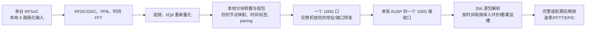

# RFSoC 频率分发与 KU5P 接收缓存：首要工作包 AF-000

2026-11-03。本文是设计与解析预算，不是已实现的 RFSoC 或 KU5P 接收器。用户已将接收缓存指定为工作重点。

## 1. 先澄清接口

现有 FNIC-KU5P 有两个 QSFP28，但只有一个硬核 100G MAC/PCS。本项目当前只使用一个独立 100G 口。两个连接器不能自动当成双 100G；单 CMAC 全双工收发也不是两个独立端口。第二口的软协议/4×25G 等属于另一个需要验证的工作包。

KU15P 的“四个”是 [AMD XMP103](https://docs.amd.com/api/khub/documents/Fz8MLna3N2KIo_xWN_Iv3w/content) 的器件级硬核计数。具体板卡可以只引出两个，或者受到封装、GT 位置和时钟布线约束。KU15P 尚未选板，主模型只保留暂按双口的预算；连这两个口也未获得板卡实测证明。四口档位已从默认表移除。

## 2. 频率分发由哪些部件完成

单台 RFSoC 只处理本地 8 路，不把 2048 路集中在一台 RFSoC。总计 256 台 RFSoC。第 k 张 KU5P 负责一组频率，接收来自**每台 RFSoC**的那组频率；它拿到的是全阵列在一小段频带上的电场。

例如理想 200 MHz、4096 个保留信道、74 张单口 KU5P：前 73 张各分 56 个信道，最后一张 8 个信道。RFSoC 0 将自身输入 0–7 的信道 0–55 发给 KU0、56–111 发给 KU1，依次类推；RFSoC 1 以相同频率映射发送它的输入 8–15。其余 RFSoC 同理。

交换机通常不会替我们把一个大 UDP 包按频率拆开。RFSoC 或额外网关须先按目的频率组构包并设置目的地址/UDP 端口；交换机负责转发。它不是把整带数据复制 74 份，而是将各频率分区各发一次。控制面统一发布 `config_id → 信道组/目的节点` 映射，跨 epoch 切换，不能让各源自行改变信道归属。

这是一种分布式 corner turn：从“源/本地输入拥有整带”，变为“处理节点拥有一组频率的全体输入”。RFSoC 的本地组包、交换机连接关系、KU5P 的时间对齐共同完成，不能只用其中一段解释全部压力。

## 3. RFSoC 可能成为瓶颈，但平均出口不是全部

在 I/Q8、α=1 条件下，每台 8 输入 RFSoC：200 MHz 输出 25.6 Gb/s，500 MHz 输出 64 Gb/s。二者平均科学数据都低于一个 100G 口；所以不能仅凭“分发很多频率目的地”认定出口必然过载。1 GHz 的 128 Gb/s 则单口已经不够。

必须测量四项：

1. **F-engine 吞吐**：8 路同时 PFB/FFT、真实 ADC/DDC 输出速率、滤波器 tap 数、内部位宽和转置。按 250 MHz、每 lane 每拍一个复数，理想 200/500 MHz 总输入分别需要至少 7/16 lane 等效吞吐；现有 320 MS/s 固件的实际流水又不同。DSP 总数不能代替该验证。
2. **频率组包**：FFT 通常按时刻和 bin 流出，发往多个目的节点的包需要跨时刻拼接；要能在不停 ADC 的情况下完成局部转置和发包。
3. **pps 和描述符/仲裁**：平均 25.6 Gb/s 也可能是数百万包每秒。软件逐包发送或单一低吞吐打包状态机会先达到上限，宜由 PL 数据路径和可配置硬件目的映射完成。
4. **调度与同步**：所有源若按相同时间、相同目的顺序突发，交换机出现 incast。应采用源相关的目的顺序/相位错开及受控 pacing，再用事件仿真验证队列和延迟。

已有 RFSoC 工程是时域 I/Q16 发包，不是上述 PFB+I/Q8 的已验证实现。新路线会在 RFSoC 增加 F-engine、重新量化与按频率构包的工作，换取下游只处理所需频带。

另一个必须冻结的参数是**FFT 总 bin 数与保留 bin 数**。例如 320 MS/s 做 4096 点时间 FFT，每信道是 78.125 kHz；保留 2560 个相邻信道才约为 200 MHz。它不等同于“4096 个信道覆盖 200 MHz”的理想基准。容量模型中的 C 是最终保留信道数，必须与实际采样率、抽取和选频保持一致。

## 4. 包长改变接收可行性

新包级预算采用示例应用头 64 字节、IPv4/UDP、无 VLAN。包括以太网头、FCS、前导和帧间隙，每包除科学数据外占 130 字节；具体头格式尚未冻结。按标称 Ethernet MAC 服务速率比较，不重复扣除 PHY 编码/FEC。

理想 200 MHz、74 个目的地、满载 KU5P 的 56 个频率信道：

| 每包电场时刻数 | 科学数据字节/主包 | 每台 RFSoC 的包率 | 每台 RFSoC 端口占用 | 每满载 KU5P 端口占用 |
|---|---:|---:|---:|---:|
| 1 | 896 | 约 3.613 Mpps | 约 29.36 Gb/s | **102.6 Gb/s，超载** |
| 2 | 1792 | 约 1.807 Mpps | 约 27.48 Gb/s | **96.1 Gb/s** |
| 4 | 3584 | 约 0.903 Mpps | 约 26.54 Gb/s | 92.85 Gb/s |
| 8 | 7168 | 约 0.452 Mpps | 约 26.07 Gb/s | 91.225 Gb/s |

这说明先前“74 张”的平均载荷下限还需要包级检查：同样 74 张、同样科学数据，每包只装一个时刻时，接收端会因开销超过 100G，ring buffer 不能修复长期超载。500 MHz、187 个目的地时，一个/两个时刻的包同样不可行，四个时刻示例才将满载接收端降至约 96.125 Gb/s。

较大包降低 pps 与报文开销，却增加组包等待、时间块粒度和可能的突发。首个候选应比较 **200 MHz 的 T=2/4**、**500 MHz 的 T=4/8**，而不是预先选最大 jumbo packet。最新精确值由 [包级计算器输出](../reports/transport.md) 生成。

74 或 187 是网络入口下限；如果算法需要更多处理节点，分频更细、目的数量增加，组包负担也会改变，届时必须按新的分片重算。

## 5. KU5P 需要有界时间对齐，ring 是一种实现

建议实现按绝对时间标签组织的环形槽，而不是一个简单的字节 FIFO。逻辑键为 `(epoch, frequency_group, time_block_id)`，物理槽号可取 `time_block_id mod W`。槽内保存绝对 generation 标签，不能仅按取模地址判断新旧数据。

对于一个包包含一个源的全部本地输入、负责频率和 T 个时刻的布局，每槽至少包含：

- 256 源的到达/有效 bitmap，源 ID 与天线/极化映射。
- 时间范围、频率范围、config/epoch、格式、状态和截止时间。
- 原始电压数据，或者该模式的线性部分累加状态。
- 重复、迟到、缺失、损坏、超前和溢出的原因计数。

同一槽全部预期源到齐可立即处理；未到齐则按既定截止释放，并携带有效掩码/权重。过期包不能覆盖已经推进到下一代的槽。窗口耗尽时按明确定义的块/包粒度拒收并记账，不能默默延长积分窗或暂停真实 ADC。

时间预算分成：源端组包等待、网络差分到达抖动、接收流水与计算释放时间、端到端科学时延。共同的组包等待不等于差分乱序，不能把 164 µs 的包时间覆盖直接当成 164 µs 的 KU5P 驻留时间。

原始数据的连续窗口下限近似 `Rscience/8 × J`，实际按完整块取整，加 generation/bitmap、正在接收/读取的槽和释放停顿预算。示例 200 MHz、T=2、100 µs 差分窗口，加两个假定 guard block：5 槽约 **2.188 MiB** 原始电压；这还没有算法工作区，也没有证明 guard 数足够。因此 1.125 MB 的连续速率乘窗口公式只能用作起点。

## 6. 不必默认将全部电压写入 DDR

比较两个核心实现：

**原始电压环形槽**：包先写入确定的源/时间/频率位置，然后按计算需要读取。布局清晰、利于复现，但需要完整缓存和转置，若走 DDR 还涉及写加读。

**到包即执行线性部分**：直接波束可在包到达时做独立权重乘法，累加到对应时间槽；EPIC 可先累加到网格。到齐/截止后再提交波束或进行空间 FFT。这样可能省去完整原始电压重排区，但仍需要源 bitmap、时间槽、冲突处理、足够宽的累加器和确定的有效权重。EPIC 网格可能比原始电压更大，不能默认省内存。若使用中途饱和或非线性舍入，还必须检验乱序到达是否改变结果。

两种模式都需要有界状态；第二种并不等于不需要时间对齐。是否允许保存原始电压作触发后复查，也会影响最终选择。

## 7. DDR 约束与调度协同

90 Gb/s 科学数据全量落 DDR 再读，最低要求 22.5 GB/s 有效读写总和；这是与 100G PHY 线速不同的科学数据预算。ECC 64bit 数据位宽在 2400/2666.7/3200 MT/s 理论上只有约 19.2/21.33/25.6 GB/s。实际刷新、仲裁、小块访问和读写换向还会降低吞吐，必须先核实实际 MIG。

因此 AF-000 应优先回答：能否通过源端 pacing、时间对齐的片内槽、线性累加及较低单片承接率，避免所有数据持续写读单 DDR 通道？若不行，就要降低单片负责的信道数、增加节点，或选更高内存带宽的板卡。增加 ring 容量无法弥补长期吞吐不足。

以 200 MHz、T=2 为例，单个目的地在同一块周期会收到 256 个主包。理想化完全同步突发约 0.492 MB，串行通过 100G 口约 39.36 µs，而块周期只有 40.96 µs。实际多级交换会改变到达分布，但该例已经说明源端目的顺序和 pacing 必须与交换机队列预算一起设计。到达 KU5P 之前丢失的包，KU5P 再大的 ring 也恢复不了。

## 8. AF-000 的具体交付与验收

当前已完成解析预算。下一步首先做离线事件参考，不连接硬件：

1. 参数化 256 源、频率分片、T、源端组包缓冲、端口速率和调度。
2. 对比同序突发、目的顺序旋转、相位错开与 pacing；记录每端口峰值队列和最坏源间到达差。
3. 注入乱序、丢包、重复、迟到、跨 epoch、超前包、窗口回绕和计算反压，验证无串窗、无重复贡献、有限缓存和显式损失。
4. 比较原始电压槽和到包即线性累加的内存/访问率；给出槽宽、深度、deadline、满窗口策略和科学有效权重。
5. 再将通过的契约实现为 KU5P 接收 RTL；RFSoC F-engine/打包器和 DDR 混合读写分别测资源与持续吞吐。

AF-000 完成以前，容量表的网络片数和裸算术吞吐都不能被称为端到端可持续能力。长时间科学触发电压缓存继续作为独立工作包，不混入短时重排承诺。
