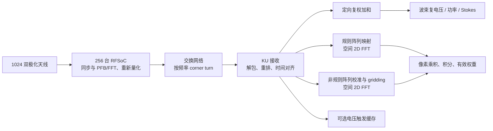

# ApertureForge：架构与可行性初案

日期：2026-11-03。证据等级：资料核对与解析计算。没有新的 SYNTH、ROUTED 或 BOARD 结果。

## 1. 建议与问题定义

KU5P 可以作为频率分片后的一个处理节点，值得继续用现有板卡做原型。1024 天线双极化、200 MHz 带宽已经是数 Tb/s 的系统；少量 KU5P 无法在保留全部天线电压和视场的前提下承接它。KU15P 可显著改善接口、LUT 和缓存，但并不是相应倍数的 DSP 升级。

建议项目名 **ApertureForge（孔径工坊）**，GitHub 仓库名 `apertureforge-fpga`。目标是测出三种算法在给定精度和接口条件下的**可持续处理包络**，输出“每片带宽 × 波束数/网格 × 科学输出 × 缓冲约束”，最后决定器件和数量。

用户已确认：1024 个物理天线、双极化；可调谐范围 0.5–1.5 GHz，优先 200 MHz 同时带宽，扩展至 500 MHz。波束数量、输出类型和时间分辨率由后续综合与科学需求共同选择。

## 2. 硬件事实和待定项

现有工程：`D:/work/KU5P_FX_Accelerator`，本轮读取的本地 HEAD 为 `956f84cea5569ef2c2d1910ce82e468f8bc4b6da`，分支 `codex/xdma-bounded-retry-2026-11-02`，读取时工作区干净。已用 GitHub 相同提交核对硬件摘要。GitHub `main` 仍有较旧 TODO，不能用它覆盖较新记录。

| 项目 | 现有证据 | 对本项目的约束 |
|---|---|---|
| 板卡 | MicroPhase FNIC-KU5P Rev1.0 | 厂家资料已核对，完整实物丝印仍可在未来复核 |
| 料号 | XCKU5P-1FFVB676I，Vivado 名 `xcku5p-ffvb676-1-i` | 主测试固定该封装和 -1 速度等级 |
| 网络 | 两个 QSFP28，KU5P 一个硬核 100G MAC/PCS | 单 100G 为基准；第二口需要独立可用的 MAC/PCS/FEC，或 4×25G 等方案 |
| DDR4 | 厂家手册第 5 章描述 72 bit MIG，ECC 使用其中 8 bit；原理图有五个 DDR4 器件位置，标注 MT40A512M16LY-062E | 先按 ECC 时 64 bit 科学数据位宽评估；容量、实装、MIG 速率与持续效率未验收 |
| PCIe | 板级目标 Gen3×8；历史 e6 为 Gen3×4 枚举证据，稳定 DMA 尚未验收 | 不能把名义 PCIe 带宽当成已可用出口，更不能据此连续搬出满口原始电压 |
| RFSoC | 旧工程为 XCZU47DR-FFVE1156-2-I，8 路复数、I/Q16、320 或 100 MS/s 项目 | 旧工程尚未提供本项目假设的科学 PFB/FFT+I/Q8 发包格式；迁移 F-engine 是新工作 |

DDR 证据来自此前提取的本机厂家资料文本，当前旧项目 hardware.md 的 DDR 条目仍是 TODO。这里记录新的静态线索，不宣称已有 DDR 测试，也不将型号后缀的器件额定速率当成板上工作速率。容量不先计入可用预算；先核实地址线、DQ/ECC 接线和可重建 MIG。

AMD 官方资源比较如下，均为器件级最大资源，不能替代具体板卡接口和封装检查：[AMD XMP103](https://docs.amd.com/api/khub/documents/Fz8MLna3N2KIo_xWN_Iv3w/content)。

| 器件 | LUT 约数 | DSP48E2 | BRAM / UltraRAM，Mb | 硬核 100G 数量 |
|---|---:|---:|---:|---:|
| KU5P | 217k | 1824 | 16.9 / 18.0 | 1 |
| KU11P | 299k | 2928 | 21.1 / 22.5 | 2 |
| KU15P | 523k | 1968 | 34.6 / 36.0 | 4 |

KU15P 相对 KU5P：DSP 仅约 1.079 倍，LUT 约 2.41 倍，片内 BRAM+URAM 约 2.02 倍。若瓶颈是复乘，它可能只带来小幅提升；若瓶颈是解包、存储端口、转置或入口，则提升可能明显。**KU11P 应纳入比较**：其 DSP 约为 KU5P 的 1.61 倍，且有两个硬核 100G；成本、供货、许可证和具体板卡仍需后续询价与核实。

接口口径澄清：上表的 KU15P“四个”来自器件级硬核数量，不是已选板卡的四个可用接口。KU15P 尚未选板，主容量表暂按双口假设；KU5P 保持当前单 CMAC/单口方案。早期默认表中 KU5P 200G 聚合与 KU15P 四口档位容易与实际硬件混淆，现已移出默认模型；如未来单独研究，必须先验证 MAC/PCS、GT、封装、板上布线与时钟。

## 3. 统一数据模型

设 N=1024、P=2、B 为所处理科学带宽，q 为一个复数的总位宽，α 为“保留信道总复样本率 / B”。临界采样、全部保留且无额外过采样时 α=1；过采样 PFB、保护带或保留较宽数字通带会增大 α。

`Rin = N × P × B × α × q`。

本轮 q=16，即 I/Q 各 8 bit。它是 PFB 后重新量化的位宽，不是 RF-ADC 原生位数。PFB 将一个宽带拆成许多窄带，**不会自行压缩这条总数据率**。增加频率通道数不降低主波束合成和成像的总运算率，但会增加系数、状态和输出记录数量。

| 同时带宽 | 总科学数据 | 每台 RFSoC 的 8 路科学数据 | RFSoC 数量 |
|---|---:|---:|---:|
| 200 MHz | 6.5536 Tb/s | 25.6 Gb/s | 256 |
| 500 MHz | 16.384 Tb/s | 64 Gb/s | 256 |
| 1 GHz 对照 | 32.768 Tb/s | 128 Gb/s | 256 |

200/500 MHz 时单台 RFSoC 的一个 100G 口可容纳这些假设下的科学数据；1 GHz 时一个 100G 口不够，需双口、减位宽或减带宽。200 MHz 的 25.6 Gb/s 已超过单 25GbE 的标称速率。上述均未把 ADC 的 I 和 Q 各算成一根天线。

如果仍发送 320 MS/s 的全部 I/Q8，即使其中仅 200 MHz 是好通带，也要按 α=1.6 计算；只有 RFSoC 实际过滤/抽取/丢弃无用频率数据后，才能使用 200 MHz 的理想入口预算。α=16/15 也要单独扫描。抗混叠、PFB 边缘通道和 RFDC 支持的采样/抽取配置另行设计。

## 4. 频率分片与板卡数量

基准采用 4096 个等宽信道、一张处理板接收所负责信道上的全部 2048 路输入。每个 100G 端口仅按 **90 Gb/s 科学载荷**使用，这是规划余量，尚非协议实测效率。全阵列各信道的平均科学负荷分别为 1.6、4、8 Gb/s。

| 板级入口假设 | 200 MHz 连续/整信道下限 | 500 MHz 连续/整信道下限 | 1 GHz 连续/整信道下限 |
|---|---:|---:|---:|
| 现有 KU5P，1×100G | 73 / **74** | 183 / **187** | 365 / **373** |
| KU15P/KU11P 候选板，暂按 2×100G 假设 | 37 / **37** | 92 / **92** | 183 / **187** |

这些是**入口下限**，没有加算法、缓存、输出、冗余和备件。例如 200 MHz 的 KU5P 单片装 56 个信道，约 2.734375 MHz、89.6 Gb/s；4096/56 向上取整得到 74 片。现有板的第二个 QSFP28 不自动满足“200G 聚合入口”。KU15P 双口仍需具体板卡核实。包长、报文头和发包块还可能使入口方案超载，须继续检查 [包级预算](../reports/transport.md)。

交换系统须按 **256 个 RFSoC 源端口 + 处理端口 + 级联端口**估算端口数量，并核对 corner turn 的无阻塞带宽、incast 和队列。不能仅用 6.55 Tb/s 除交换机标称交换容量；不同厂商的单/双向容量口径也需核实。

## 5. 三条算法路线

共同数据流：

### 5.1 任意阵列的相干波束合成

`Cbf = N × P × M × B × α` complex-MAC/s，M 为同时输出的方向数。对角校准可折叠进波束权重；完整 2×2 Jones 校准需额外预算或明确折叠方式。

200 MHz 时每增加一个双极化波束，增加 0.4096 Tcomplex-MAC/s。采用“250 MHz、70% DSP、每通用复乘 4 DSP”的占位模型，KU5P 约 79.8 Gcomplex-MAC/s，KU15P 约 86.1 G。这里的 70% 是留给其他运算与实现余量的建模选择，250 MHz 尚未在本设计的 -1 料号上证明。

| 200 MHz，全 1024 天线 | KU5P 单 100G | KU15P 假设 2×100G |
|---|---:|---:|
| 1 波束 | 74 | 37 |
| 4 波束 | 74 | 37 |
| 16 波束 | 84 | 78 |
| 64 波束 | 342 | 316 |

表中是网络、通用乘法和整信道粒度共同作用的**模型值**，尚未计入其他资源，因此也不是已证明充分的配置。3 乘法复乘、低位宽打包或 LUT 算术可能降低 DSP，时序和存储又可能增加板数。它说明：少数波束时增加入口很有价值，多波束时 KU15P 的接口优势很快被算术吞吐限制。

波束电压若采用 I/Q16，200 MHz 下每个双极化波束的总输出为 12.8 Gb/s；必须分别预算出口。以太网全双工可同时收发，入口和出口分方向核算。每信道/天线/极化/波束的权重若为 I/Q16，需要 `N×P×M×L×4` 字节，双份更新再乘二；不能每做一次复乘就从 DDR 读一个权重，应利用片内缓存和时间块复用。

### 5.2 规则 FFTT

时域 PFB/FFT 与这里的**空间 FFT**是不同操作。对规则、近共面、可校准的阵列，将电场按真实几何映射后做空间 FFT，可同时得到规则方向集合的电场波束。[FFTT 原始论文](https://journals.aps.org/prd/abstract/10.1103/PhysRevD.79.083530)。

1024 天线的 32×32 布局适合作为基准，但 32×32 电场波束格不能默认等同于充分采样的功率成像。平方后空间频谱支持扩展，为避免循环混叠及改善像素采样，必须比较 64×64 的补零版本，并验证图像边界与视场。[EPIC 对补零和运算量的说明](https://epic-astronomy.org/docs/theory/epic-algorithm)。

采用完整 radix-2 蝶形计数，单极化一次 G 点 2D FFT 约 `G/2×log2(G)` 个蝶形。全带每秒需要 `P×α×B` 次单极化空间变换。200 MHz 时，32²、64²、128² 分别约为 2.048、9.8304、45.8752 Tbutterflies/s。它们不是同等成本的“1024 天线模式”。

脚本提供未优化的通用蝶形、独立增益校准、全 Stokes 乘积模型：200 MHz 的 64² FFTT 得到 KU5P 约 152 片、KU15P 约 142 片的占位值。**这既不是资源下界，也不是实现承诺**：平凡旋转因子、补零剪枝、低位宽和常数乘法可大幅减少 DSP，转置/端口/位宽增长又可能成为更强约束。其用途是促使我们尽早综合完整的 2D FFT，而不是仅综合一个一维 FFT IP。

### 5.3 非规则阵列 EPIC

路径为校准电场 → 每天线卷积栅格化 → 空间 FFT → 像素极化乘积 → 积分。它避免显式计算全部基线，但成本取决于**网格 G 和卷积核支持面积 K**，不能仅用 N log N 给出板数。平方和积分的顺序不能互换；把图像输出从 1 ms 改为 100 ms，不会让前面的每样本空间 FFT 减少 100 倍。[EPIC 算法说明](https://epic-astronomy.org/docs/theory/epic-algorithm)。

额外 gridding 约为 `N×P×K×α×B` 个复乘加每秒。200 MHz、3×3 核对应约 3.6864 T 次，5×5 核约 10.24 T 次。还要处理多个天线更新相同网格位置的写冲突、网格清零、累加位宽和系数读取，不能假设 URAM 有无限写端口。核大小须经过成像误差检验，最近邻仅作控制实验。

同一通用模型下，200 MHz、64²、3×3 核占位值约为 KU5P 196 片、KU15P 187 片；5×5 核分别约 293 和 274 片。这些数值不能用于采购。应以“真实 gridding + 完整 2D FFT + 乘积/积分”的 routed 实现替换。

2026 年公开 FPGA EPIC 原型在 Alveo V80 上报告了 64² 单核约 6 MHz 双极化吞吐及多核约 50 MHz 容量，并展示 Vivado 仿真结果；其输入规模、优化与器件均不同，不能按 FPGA 型号名称直接移植性能。该论文是值得对照的近期实现，也提醒我们将仿真、资源容量推算和真实接收流区分开。[原型论文](https://arxiv.org/html/2609.03027v1)。

## 6. 视场、频率与科学输出

视场初始采用单天线**嵌入阵列后的**主波束，建立 60°、90°、120° 全宽的假设扫描；它们是情景值，不是现有 Vivaldi 的已测 FWHM。实际应导入 E/H 面、随频率变化的嵌入单元方向图及极化响应。密布互耦可能破坏“各天线相同方向图”的简化。

对于半视场 θmax，防止规则网格空间混叠的充分采样条件近似为 `Δr ≤ λ/(2 sin θmax)`；全可见半球时退化为 λ/2。最高频率 1.5 GHz 的 λ≈0.20 m，半球采样需要约 0.10 m 间距。能否在该间距同时满足 0.5 GHz 天线性能属于天线/电磁设计约束，不能由“小型 Vivaldi”自动推出。

不规则阵列需要由物理口径 D、视场和 λ 共同决定网格，保留卷积核边缘并进行补零。固定物理口径、相同角视场下，频率从 0.5 到 1.5 GHz 可能使未取整的二维网格需求增至约 9 倍。应分别评估 0.5–0.7 GHz 与 1.3–1.5 GHz 的 200 MHz 子带。阵列若不共面，还需检验 w 项、方向相关校准和相应额外核支持/分面成本。

少量相干波束并不能覆盖整个单元视场；覆盖方向数约与 `Ωelement / Ωsynthesized` 成正比，密布 32×32 阵列可能需要数百到上千个采样方向。若目标是广视场瞬变，规则 FFTT/EPIC 比逐个直接形成全部方向更值得优先评估。方向集合随频率变化，宽带像素配准也需要预算。

时间分辨率建议扫描约 **0.1 / 1 / 10 / 100 ms**。CHIME/FRB 的公开 FFT 波束合成方案采用约 0.983 ms、24 kHz 分辨率；EPIC 的 LWA 实现采用更细的电场时刻并积分成较慢图像。这支持将约 1 ms 作为 FRB/瞬变首选档，0.1 ms 为扩展，较慢档用于低输出率成像。[CHIME/FRB](https://arxiv.org/abs/1702.04728)、[LWA EPIC](https://arxiv.org/abs/1904.11422)。这些是设计参照，不是本仪器的灵敏度保证。

200 MHz/4096 的频宽是 48.828125 kHz、每通道电场时刻间隔 20.48 µs；可用 50 个时刻得到 1.024 ms。考虑冷等离子体色散，`t_smear≈8.3 µs×DM×Δν_MHz/ν_GHz³`。例如 DM=500、0.5 GHz、48.8 kHz 时约 1.62 ms，因此 1 ms 输出并不自动等于 1 ms 科学分辨率。应扫描 4096/8192/16384 通道、目标 DM，必要时增加二级频道化或相干消色散。消色散和瞬变搜索本身不在本轮三类算术核的资源包络内，需另加系统预算。

图像输出也可能很大：4096 个频率信道、64² 像素、4 个 32bit 极化产品、1.024 ms 输出，约 **2.097 Tb/s**，即使带宽只处理 200 MHz。可通过科学允许的频率积分、ROI、只输出 I、触发保存等方式降低；频率积分必须兼顾色散和谱线需求。增加时间积分主要降低输出与读出压力，不降低每个输入时刻的 gridding/FFT 负担。

## 7. 解包、重排与 ring buffer

需要区分三种缓存：

1. **短时重排/对齐缓存**：吸收包抖动、乱序和不同源到达偏差。该功能是接收器基本组成，可用片内环形槽或分块 DDR 实现。
2. **计算工作区**：空间 FFT 行列转置、gridding 冲突消解、积分、系数与双份更新。它与重排同时占内存及端口。
3. **科学触发电压环形缓存**：保存触发前后的电场，可能需要毫秒到数秒；这是独立科学功能，不应默认由短时接收缓存承担。

单份重排窗口 `M = Rscience/8 × Δt`，另加标签/掩码/包头，双缓冲如实际采用则另乘份数。

| 按单口 90 Gb/s 科学载荷 | 单份容量 |
|---|---:|
| 10 µs | 112.5 kB |
| 100 µs | 1.125 MB |
| 1 ms | 11.25 MB |
| 10 ms | 112.5 MB |

KU5P 的 BRAM+URAM 原始总量约 4.36 MiB，还要分给算法和协议，因此不能用全部片内存储承诺 1 ms 满口电压缓存。100 µs 也要结合权重和 FFT 转置区核算。KU15P 假设双口同时输入时，同样 100 µs 已需约 2.25 MB 单份缓存，接口增加会加速消耗缓存。

若全量科学数据持续写 DDR 再读出来，90 Gb/s 入口要求至少 **22.5 GB/s 的有效读写总和**；还没有算转置、权重、刷新和小块访问。ECC 64bit 数据总线在 2400/2666.7/3200 MT/s 的理论有效数据位宽上限分别约 19.2/21.33/25.6 GB/s；前两档甚至理论上也不足，3200 档也只有很小余量。资料里出现 -062E 芯片不能证明当前 MIG 跑 3200 MT/s。按假设 75% 持续效率，单 64bit DDR 通道均不足支撑满 90 Gb/s 数据落盘后再读；应优先测量并设计绕行/分层缓冲。

可行方向：正常有序流走片内对齐槽与计算流水；只在窗口需要时使用 DDR，或降低单片承接率。DDR 采用大块突发写、分块读回与片内转置，避免每个 2 字节样本单独随机访问。旁路是否能保证全部源的同步窗口，必须由包调度和故障注入证明。

协议必须有版本、epoch/config、源/天线/极化、频率范围、首个电场时刻的时间标签、布局/位宽和有效计数。丢包/重复/迟到/溢出要进入有效掩码及积分权重，不能静默补零再按完整数据归一化；采样源不可被 KU 的 AXI ready 暂停。

发包块与重排预算要联合设计。例如 200 MHz、56 信道一片、每源 8 路、I/Q8，一个电场时刻覆盖 896 字节、20.48 µs；8 个时刻为 7168 字节、163.84 µs。大包会增加源端等待；若 100 µs 指从首时刻起算的总时延，可能不满足，但共同发包等待不等于源间差分乱序，不能简单把整个发包时间都算成 KU5P 驻留时间。应分别规定发包等待、差分抖动、计算释放时间和端到端截止时间。详见 [RFSoC 分发与缓存重点方案](corner-turn-and-buffer.zh-CN.md)。

触发缓存还要计入色散扫频时间和检出延迟，例如低频 200 MHz 子带的高 DM 扫频可能达到数秒。满口保存 1 秒需约 11.25 GB/片，且事后导出不能阻塞实时处理。优先比较 RFSoC 端、通道化处理端、波束端和主机/外置存储端的缓存位置；现有单通道 DDR 不先承诺全量长电压环形缓存。

## 8. Tile、系统规模与下一决策

仅把天线机械/布线分 tile，不改变 2048 路总数据率。若在 tile 内先形成少量方向，才会减少下游维数，但视场和可恢复信息随之改变。8 ADC 的一台 RFSoC 对应 4 个双极化天线；若它们可作为一 tile，形成一个双极化 tile 波束，在相同重新量化位宽下可将电压流数量缩小约 4 倍，同时限制到 tile 波束覆盖的视场。相干加和的内部位宽和重新量化损失必须核算。

规则 tile 可以测试分级 FFT/分级波束合成；不规则 tile 中心不能直接当规则 FFT 阵列。若保留全部独立空间模式，tile 变换本身不能带来同等倍数的无损数据压缩。

建议的选择次序：

1. 优先完成 RFSoC 分频发包、源端调度、交换机 incast 与 KU5P 时间重排/ring buffer 的联合预算和离线参考，再进行 2048 输入逻辑与单位核综合。
2. 对同一精度比较 KU5P/KU11P/KU15P，找出直接波束、补零 FFTT 和 EPIC 的实际瓶颈。
3. 将接收/重排/DDR/输出加入最有希望的设计，做 full-shell routed 验证；用实测吞吐替换解析模型。
4. 若需要少数波束，优先比较 RFSoC/tile 分级波束合成，以减少交换网络压力。若要保留整个单元视场，优先规则 FFTT，其次为精度受控的 EPIC。
5. 若 200 MHz 仍需大量 KU 卡，比较更高 DSP/片上 RAM/内存带宽的平台与 FPGA+GPU 组合，并按机箱、交换机、光模块、功耗和维护总成本决策。不能仅看 FPGA 单价。

首轮可以把 74 片单口 KU5P 当作 200 MHz 方案的入口参考规模，而不是采购清单。完整能力上限要由 [测试计划](benchmark-plan.zh-CN.md) 的可复现结果给出。当前结论是：**KU5P 有原型和分片计算价值；KU15P 可能显著改善节点集成，但无法仅靠更大型号解决多波束/大网格的算力问题。**
